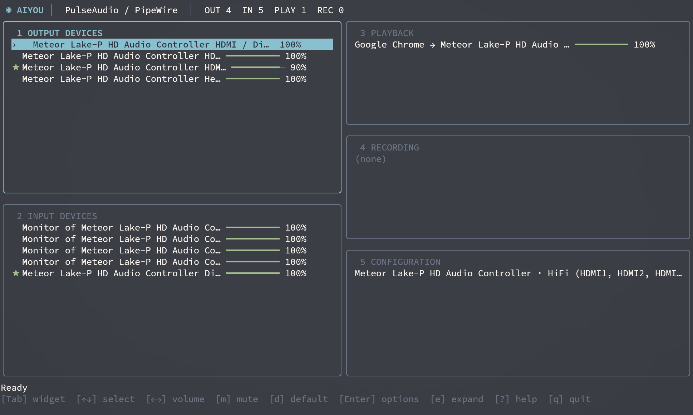

# ayou

A keyboard-driven terminal audio control center for PulseAudio and PipeWire (via `pipewire-pulse`). Inspired by [bottom](https://github.com/ClementTsang/bottom)'s focused widgets and dashboard layout, and by pavucontrol's audio controls. It uses `pactl` as its backend.



*Screenshot predates the rename; the current title is AYOU.*

## Requirements

- Linux with PulseAudio or PipeWire's PulseAudio compatibility server
- `pactl` available in `PATH`
- Optional: `bluetoothctl` for the Bluetooth alias when PulseAudio reports `(null)`
- Go 1.24+ to build from source

## Run

```sh
go run .
# or
go build -o ayou . && ./ayou
```

## Configuration

Settings are loaded once at startup from `${XDG_CONFIG_HOME:-$HOME/.config}/ayou/config.json` on Linux. If the file is absent, built-in defaults are used; nothing is written automatically. Use `--config /path/to/config.json` to choose a different file (an explicit missing file is an error). Invalid values and unknown keys fail at startup rather than silently changing behavior. Only specify the fields you want to override; the rest retain their defaults.

```sh
mkdir -p "${XDG_CONFIG_HOME:-$HOME/.config}/ayou"
ayou --print-default-config > "${XDG_CONFIG_HOME:-$HOME/.config}/ayou/config.json"
# Or inspect the bundled config.example.json and run with:
ayou --config ./config.example.json
```

| Setting | Default | Meaning |
| --- | --- | --- |
| `refresh_interval` | `"2s"` | Audio state refresh period (100ms–1m) |
| `volume_step` | `5` | Percent changed per volume keypress (1–100) |
| `layout.dashboard_min_width`, `layout.dashboard_min_height` | `70`, `20` | Minimum terminal size for the five-panel dashboard (width ≥20, height ≥16) |
| `layout.volume_bar_width`, `layout.compact_bar_width`, `layout.compact_bar_threshold` | `10`, `5`, `42` | Normal/compact bar widths and row-width cutoff |
| `theme.*` | See [`config.example.json`](config.example.json) | Seven `#RRGGBB` colors for borders, text, volume, mute, and selection |
| `backend.pactl_timeout`, `backend.bluetooth_timeout` | `"5s"`, `"1s"` | Per-command timeouts |

Configuration files use JSON (`config.example.json` contains all defaults). Durations use Go-style strings such as `"500ms"` and `"3s"`. Keybindings and widget order are currently fixed, not user settings. CLI flags select a file or print defaults; they do not override individual fields in a file.

## Layout

On a wide terminal, all five bordered widgets share one dashboard. The left column contains **1 Output Devices** (speakers/headphones) above **2 Input Devices** (microphones/monitor sources). The right column contains **3 Playback** (application audio), **4 Recording** (applications capturing audio), and **5 Configuration** (card profiles), top to bottom. **★** at the start of a device row marks the default output or input, even when that row is selected or its name is truncated. A focused widget has a cyan border and highlighted selection. On narrow terminals or in expanded mode, only the focused widget is shown. `Tab` and keys `1`–`5` follow this numbered order; directional focus uses the widgets' screen positions.

## Keys

| Keys | Action |
| --- | --- |
| `Tab` / `Shift-Tab`, `1`–`5` | Switch widgets |
| `Ctrl`/`Shift` + arrows, uppercase `H`/`J`/`K`/`L` or `W`/`A`/`S`/`D` | Move focus to the widget above/left/below/right (no wrap at edges) |
| `↑`/`↓` or `j`/`k` | Select an item |
| `Home`/`End`, `g`/`G`, `PgUp`/`PgDn` | Navigate a list |
| `←`/`→`, `h`/`l`, `-`/`+` | Adjust selected volume by `volume_step` (default 5%) |
| `m` | Toggle mute for a selected stream or device |
| `d` | Set selected output/input device as default |
| `Enter` or `p` | Choose destination for a stream, port for a device, or profile for a card |
| `e` | Expand or collapse selected widget; while expanded, switching widgets is disabled until `e` or `Esc` |
| `/` | Filter the focused widget by name (case-insensitive); hide non-matching rows. `Enter` keeps the filter |
| `n`/`N` | Select next/previous matching row when filtered |
| `Esc` | Stop typing without clearing the filter; press again to clear it. Also closes menus/help or collapses expanded view |
| `?` | Show help |
| `r` | Refresh now (automatic refresh uses `refresh_interval`, default 2s) |
| `q` or `Ctrl-C` | Quit |

Selecting a card profile can change which inputs and outputs are available. Monitor sources are listed alongside microphones. Volume display averages channels; controls currently change all channels together. This is not a full replacement for pavucontrol: per-channel volume, balance, and advanced device settings are not supported.

## Project structure

- `main.go` — composition root: checks for `pactl`, wires the backend and starts Bubble Tea.
- `internal/audio/` — audio snapshot types, operations and backend interface; no CLI or TUI dependencies.
- `internal/pactl/` — adapter for `pactl` JSON, commands and optional Bluetooth names.
- `internal/ui/` — Bubble Tea state and key handling (`model.go`, `navigation.go`, `actions.go`, `update.go`), rendering (`view.go`) and styles (`theme.go`).

The UI depends on the `audio.Backend` interface, not directly on `pactl`, so tests use a fake backend without touching system audio. Go's `internal` packages keep implementation details private to this module.

## Tests

```sh
go test ./...
go vet ./...
```
